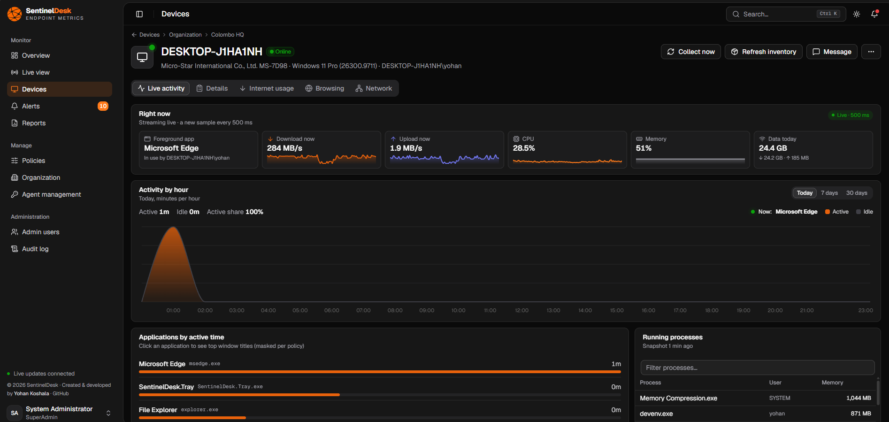
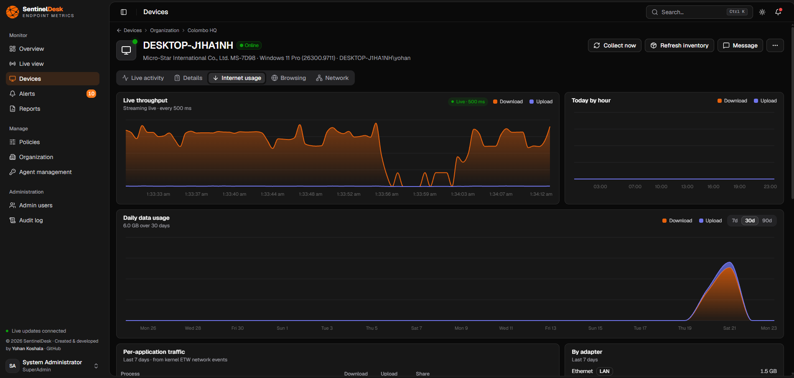

<p align="center"><picture><source media="(prefers-color-scheme: dark)" srcset="docs/images/SentinelDesk-logo-dark.png"></picture></p>

# SentinelDesk — Endpoint Monitoring & Management

SentinelDesk puts a protected Windows tray agent on every company PC and laptop and gives you one central web console
with a real-time view of the whole fleet. You can see device health, application and internet usage, hardware and
software inventory, USB activity and security posture, and get alerts when something changes.

**Version 1.2.0** · Windows 10/11 (x64) agents · Windows Server or Windows 10/11 for the server

## Screenshots

**Live activity:** what a device is doing right now (foreground app, live download and upload, CPU, memory, data
used today), plus active and idle time by hour, applications by active time and running processes.



**Internet usage:** live throughput, today's usage by hour, daily data usage over 7/30/90 days, traffic per
application and usage per network adapter.



## Downloads

All files are in [releases/](releases/).

| File | What it is |
|---|---|
| `SentinelDesk-Server-1.2.0-win-x64.zip` | The central server: web console and agent API. Self-contained, so no .NET install is needed. |
| `SentinelDesk-Setup.exe` | One-file agent installer for PCs. It asks for the server address, token and uninstall key. |
| `SentinelDesk-Agent-1.2.0.zip` | Agent package for scripted deployment (GPO / Intune / SCCM) and for upgrades from the console. |

### Web console

[web-console/](web-console/) holds the built web console: the admin dashboard you open in the browser. The server
zip already contains the same files in its `wwwroot` folder and serves them itself, so a normal install needs
nothing extra.

The separate copy is for hosting the console behind your own web server or reverse proxy (IIS, nginx). In that case,
send `/api`, `/hubs` (SignalR WebSockets) and `/agent` (agent traffic, if it uses the same hostname) to the
SentinelDesk server, and send every other path to `index.html`.
The console does not work without the SentinelDesk server.

## 1. Install the server

1. Extract `SentinelDesk-Server-1.2.0-win-x64.zip` to the server, for example `C:\SentinelDesk`.
2. Edit `appsettings.json`:
   - `Server:PublicUrl`: the address your offices will use, for example `https://monitor.company.lk`
   - `Kestrel`: the HTTPS certificate for that hostname
   - `Organization:Name`, `Notifications` (SMTP / webhook) and `Retention` as needed
   - Keep `Demo:Enabled` set to `false`.
3. Register and start it as a Windows service (Administrator prompt):

   ```powershell
   sc.exe create SentinelDeskServer binPath= "C:\SentinelDesk\SentinelDesk.Server.exe" start= auto
   sc.exe start SentinelDeskServer
   ```

4. Open the console (`https://<your-server>:5443`, or `http://localhost:5080` on the server itself) and sign in as
   `admin` / `ChangeMe@2026`. You must set a new password at first sign-in.
5. Open only port 443 (agents + console) through your firewall or reverse proxy.

All data and key material is stored in the `data\` folder next to the server. **Back up that folder regularly.**

## 2. Install the agent on PCs

### Recommended: one installer per office

1. In the console open **Agent management → Office installer**.
2. Pick the branch, enter the server address the offices can reach and your uninstall key, then click **Download setup**.
3. You get `SentinelDesk-Setup-<Branch>.exe` with everything built in. Staff double-click it (administrator / UAC),
   or IT installs it silently:

   ```
   SentinelDesk-Setup-<Branch>.exe /quiet
   ```

   Exit code `0` means it installed. The log is in `C:\Windows\Temp\SentinelDesk-Install.log`.

### Generic installer

`releases/SentinelDesk-Setup.exe` asks for the values when it runs, or you can pass them on the command line:

```
SentinelDesk-Setup.exe /server https://monitor.company.lk /token SD-XXXX /key <uninstall key> [/pin SHA256] [/tofu] [/quiet]
```

Create enrollment tokens in the console under **Agent management → New token**.

### Scripted deployment (GPO / Intune / SCCM)

Extract `SentinelDesk-Agent-1.2.0.zip` and run this elevated:

```powershell
powershell -ExecutionPolicy Bypass -File install-agent.ps1 -ServerUrl https://monitor.company.lk `
  -EnrollToken SD-XXXX -UninstallKey "<organisation uninstall key>"
```

## 3. Upgrade agents

Upload `SentinelDesk-Agent-<version>.zip` in **Agent management → Releases**, then roll it out in stages:
10 % → 50 % → 100 %. Raising the percentage only adds devices; devices that are already upgraded stay upgraded.

## 4. Uninstall the agent

Use **Apps & features → SentinelDesk Agent**, or run `C:\Program Files\SentinelDesk\Uninstall.exe`.
Uninstalling needs administrator rights **and** the Uninstall Key, or a one-time code for that device from the console.

Silent: `Uninstall.exe /S /key=<key>` (exit code `0` means it was removed). After 5 wrong keys, uninstalling is locked
for 30 minutes and the console is alerted.

## Features

- **Tray agent on every PC:** visible shield icon with status, monitoring notice and contact support. Users cannot exit it.
- **Tamper protection:** services that only SYSTEM can stop or remove, a watchdog that restarts the agent, and alerts
  for stops, kills, changed files and changed service settings. Devices that go silent for more than 24 h raise an alert.
- **Strong encryption:** TLS 1.2/1.3 with per-device certificates, AES-256-GCM encrypted data and signed policies,
  commands and updates.
- **Central policies:** collectors, intervals, title masking, excluded apps and domains, working hours and USB
  blocking, assigned to offices or devices and pushed instantly.
- **Detailed device view:** live gauges, hardware, software history, applications, bandwidth, websites, sessions,
  USB, security posture, timeline and remote commands.
- **Island-wide:** agents connect outbound over HTTPS only, keep working offline, and appear on a branch map with an
  organisation → region → branch → department hierarchy.
- **Console:** dashboard, live view, alerts and rules (email / webhook), reports with CSV export, admin users with
  roles and MFA, audit log, and light and dark themes.
- **Device location (optional):** off by default. When a policy enables it, devices appear on the map with a 30-day trail.

## Privacy

SentinelDesk shows a visible tray icon and monitoring notice. It **does not** record keystrokes, screenshots or file
content. Web logging is domain-level only, and window titles are masked by default. You can exclude apps and domains
and limit collection to working hours. HR viewers cannot see websites, window titles or live activity, and every view
and export is audited.

Install only on company-owned devices, and have HR and legal approve your monitoring policy before rollout
(for example, under Sri Lanka's PDPA No. 9 of 2022).

## License

**Proprietary software. © 2026 Yohan Koshala. All rights reserved.**

You may use SentinelDesk only with a written license from the author. See [LICENSE](LICENSE) for the full terms.
Bundled open-source components remain under their own licenses.

Licensing and support: [www.lordefx.com](https://www.lordefx.com) · [github.com/tenzaicbt](https://github.com/tenzaicbt)
